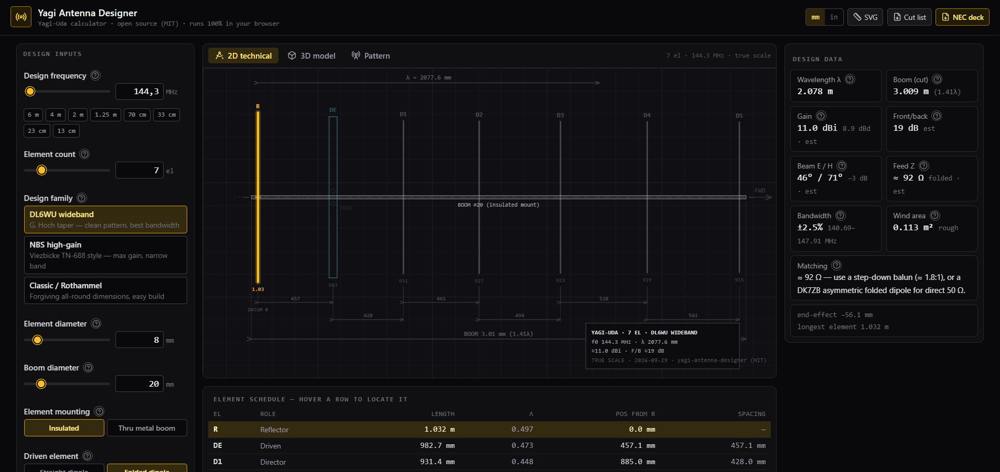
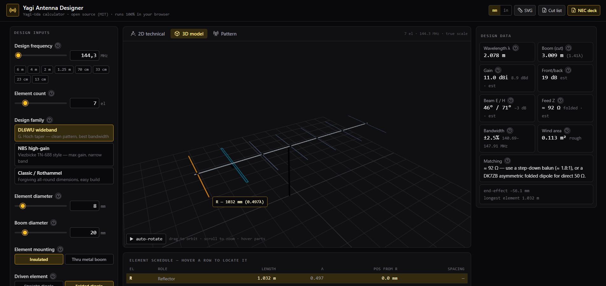

# Yagi Antenna Designer

An open-source, online **Yagi-Uda antenna designer and calculator** that runs entirely
in the browser. Enter frequency, element count, tubing sizes and mounting style —
get a full cut list, performance estimates, a dimensioned technical drawing, a 3D
model, and an exportable NEC deck for verification.

**Live demo:** https://yagi-ls1.pages.dev/


## Screenshots

2D technical drawing with element schedule:



3D model with hovered part tooltip:



## Features

- **Strict-ish RF engineering** — parametric models of the published DL6WU, NBS
  (TN-688) and classic Rothammel/ARRL design families, with:
  - end-effect shortening interpolated for your exact element diameter (d/λ),
  - Rothammel boom correction when elements pass through a metal boom,
  - gain / F/B / beamwidth / feed-impedance estimates fitted to published measurements.
- **Informative** — every parameter and every result has a **?** badge that opens a
  modal explaining the underlying theory, with a diagram, formulas, and reference links.
- **Linked views** — hovering a parameter, result, or cut-list row highlights the
  corresponding part in the **2D technical drawing** and the **3D model** (and
  hovering 3D parts highlights back).
- **2D technical drawing** — true-scale, fully dimensioned SVG with title block,
  exportable as `.svg`.
- **3D rendering** — orbitable three.js model with mast, feed box, insulators,
  folded-dipole option, and clamped in-view part tooltips.
- **Pattern sketch** — E/H-plane polar plots derived from the estimates.
- **Exports** — SVG drawing, CSV cut list, and a **NEC-2 deck** (`.nec`) for
  4nec2 / xnec2c verification. Always verify before cutting metal.
- **No backend** — the whole calculator runs locally in the page (see below), so
  it deploys to any static host.

## User guide

1. **Pick a band** — use a preset chip (6 m … 13 cm) or dial in any frequency
   from 3 MHz to 6 GHz.
2. **Choose a design family** — DL6WU wideband is the best default; NBS squeezes
   out maximum gain on a narrow band; Classic is forgiving to build.
3. **Set mechanics** — element/boom diameters, insulated vs. thru-metal mounting,
   straight vs. folded driven element. Click any **?** badge for the theory.
4. **Inspect the views** — 2D technical tab for dimensions, 3D tab to orbit the
   model, Pattern tab for the E/H-plane sketches. Hover rows and parts to locate them.
5. **Export before building** — download the SVG drawing, the CSV cut list, and the
   NEC deck; run the deck in 4nec2/xnec2c and re-tune against the SWR sweep before
   cutting metal.

All performance figures are **estimates** — the app labels them as such wherever
they appear.

## Quick start

Requirements: Node.js 18+ and npm.

```bash
npm install
npm run dev
```

Then open http://127.0.0.1:5173 in a browser.

Production build and local preview:

```bash
npm run build
npm run preview
```

## Deploying

The build output (`dist/`, generated by `npm run build`) is a fully static site —
drop it on any static host. The live demo runs on Cloudflare Pages.

### Cloudflare Pages via wrangler (direct upload)

```bash
npm run build
wrangler pages project create yagi --production-branch=main  # once
wrangler pages deploy dist --project-name=yagi
```

The first deploy prints your `*.pages.dev` address (e.g.
`https://yagi-ls1.pages.dev`). Re-run `npm run build && wrangler pages deploy dist
--project-name=yagi` for every update. Alternatively, connect the Git repo in the
Cloudflare dashboard (Pages → Create → Connect to Git) with build command
`npm run build` and output directory `dist` for automatic deploys on push.

### Any other static host

Serve `dist/` from GitHub Pages, Netlify, Vercel, nginx, or plain file hosting —
no server-side code or environment variables required.

## Do I need a backend?

**No.** Everything — geometry, estimates, drawings, 3D, exports — is computed
client-side from closed-form models and tables. A backend would only become
useful for:

1. a server-side NEC/MoM solver (accurate gain/SWR sweeps),
2. saved/shared designs with user accounts,
3. community design galleries or optimisation runs.

The NEC deck export is the bridge: it lets you verify every design in a real
electromagnetic solver today, with zero infrastructure.

## Theory notes

- Wavelength uses c = 299 792 458 m/s (exact).
- Thin-wire resonant dipole ≈ 0.477λ (the 143/f rule); fat elements resonate
  shorter — interpolated from Rothammel/ARRL curves.
- Reflector ≈ +5% over resonance (inductive), directors ≈ −5…−10% (capacitive)
  with per-family taper; spacings per family (DL6WU growing, NBS 0.2λ, classic 0.24λ).
- Gain is interpolated from NBS TN-688 / DL6WU boom-length data; beamwidth from
  D ≈ 41253/(θE·θH); feed Z from an exponential coupling-decay fit.
- All performance figures are **estimates** (±~0.5 dB typical for gain, worse for
  F/B). The app says so wherever they appear.

### References

- P. P. Viezbicke, *Yagi Antenna Design*, NBS Technical Note 688, 1976.
  ([PDF](https://nvlpubs.nist.gov/nistpubs/Legacy/TN/nbstechnicalnote688.pdf))
- G. Hoch (DL6WU), Yagi optimisation series, DUBUS.
- K. Rothammel, *Antennenbuch*.
- *ARRL Antenna Book* (Yagi chapters).
- C. A. Balanis, *Antenna Theory*.
- M. Steyer (DK7ZB), [optimised Yagi designs](https://www.qsl.net/dk7zb/).
- [4nec2](https://www.qsl.net/4nec2/) antenna modelling software (for verifying
  the exported NEC decks).

## Project layout

```
public/
  screenshot_1.png   # README screenshot: 3D view
  screenshot_2.png   # README screenshot: 2D view
src/
  lib/
    yagi.ts        # design engine: geometry + estimates (pure logic)
    info.ts        # ? modal content: theory, formulas, links per parameter/result
    highlight.ts   # shared highlight contract between panels and views
    format.ts      # metric/imperial formatting
    exporters.ts   # CSV / NEC-2 deck / SVG-download helpers
  components/
    ControlsPanel.tsx  # inputs
    ResultsPanel.tsx   # design data + warnings
    ElementTable.tsx   # cut-list schedule
    Drawing2D.tsx      # true-scale SVG technical drawing
    Viewer3D.tsx       # three.js model (orbit, hover, tooltips)
    PatternPlot.tsx    # E/H polar sketches
    InfoBadge.tsx      # ? badge + theory modal (diagrams, references)
    InfoFigure.tsx     # inline SVG explainer diagrams for the modals
    ParamField.tsx     # labelled input wrappers with highlight wiring
  App.tsx
  main.tsx
  index.css
```

## Contributing

Issues and PRs are welcome. High-value contributions:

- **Measured-vs-predicted comparisons** — built one of these designs? Report real
  SWR/gain/pattern measurements (with setup details) so the estimate fits improve.
- **More design families** — DK7ZB, G0KSC LFA/OWA, … ideally with a published
  reference and a NEC cross-check.
- **Internationalisation** — the UI strings are currently English-only.
- **Tests** — the pure engine in `src/lib/yagi.ts` is the natural first target
  (golden dimension tables per family/band).

Ground rules:

1. **Estimates must be labelled as estimates** — never present a fitted number as
   simulated or measured.
2. Keep the math dependency-free and client-side (`src/lib` imports nothing from
   `src/components`).
3. Run `npm run build` (typecheck + production build) before opening a PR.
4. Match the existing dark engineering-drawing aesthetic for UI work.

## License

MIT — see [LICENSE](LICENSE).
